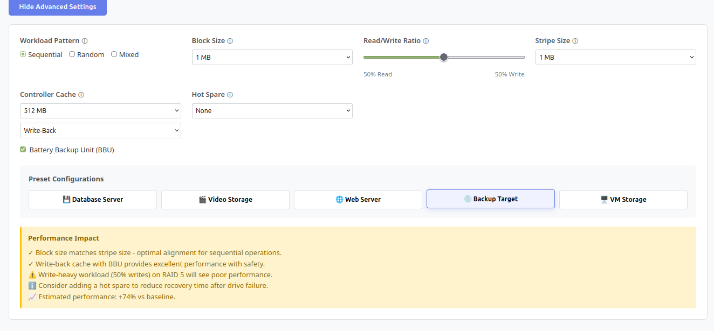
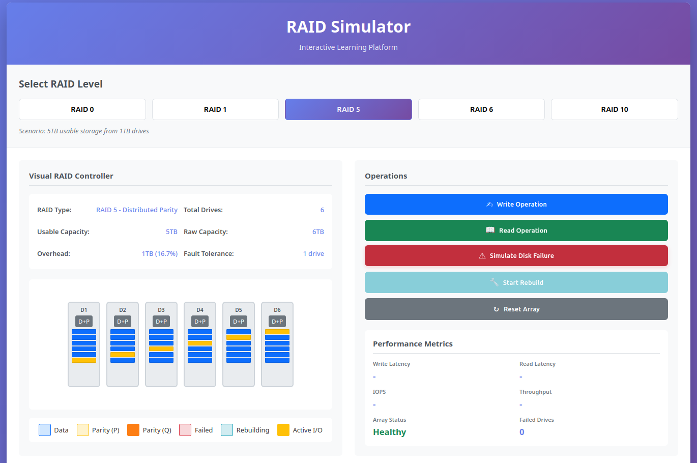

# RAID Simulator - v2.0.0

An interactive web-based simulator for learning RAID (Redundant Array of Independent Disks) concepts through hands-on experimentation.

## Latest Updates (v2.0.0 - Phase 2: Advanced Settings)

### New Features
- **7 Advanced Configuration Parameters**:
  - I/O Pattern Selection (Random/Sequential/Mixed)
  - Block Size Configuration (4KB - 1MB)
  - Read/Write Ratio Slider
  - Stripe Size Tuning
  - Controller Cache Settings (size, policy, BBU)
  - Hot Spare Configuration

- **5 Preset Configurations**:
  - Database Server (optimized for random I/O, low latency)
  - Video Storage (optimized for sequential, high throughput)
  - Web Server (optimized for read-heavy workloads)
  - Backup Target (optimized for sequential writes)
  - VM Storage (balanced for mixed workloads)

- **Real-Time Performance Analysis**:
  - Performance impact indicators
  - Configuration recommendations
  - Warning messages for suboptimal settings

- **Enhanced Performance Simulation**:
  - Settings now affect calculated latency, IOPS, and throughput
  - Cache dramatically improves write performance
  - Block/stripe alignment optimization



### Previous Updates (v1.2.0)
- Fixed drive layout with columns as unique data and rows as mirrors
- Improved operation animations showing correct RAID behavior
- RAID 5/6 write penalty visualization

## Features (MVP)

- **5 RAID Levels**: RAID 0, 1, 5, 6, and 10
- **Visual Drive Representation**: See how drives are organized in each RAID configuration
- **Performance Simulation**: Execute read and write operations with realistic latency metrics
- **Failure Simulation**: Simulate disk failures and observe array behavior
- **Rebuild Simulation**: Watch the rebuild process with progress tracking
- **Real-time Metrics**: View IOPS, throughput, and latency measurements

## Quick Start

### Using Docker

1. **Build the Docker image:**
   ```bash
   cd RAID_sim
   docker build -t raid-simulator .
   ```

2. **Run the container:**
   ```bash
   docker run -d -p 80:80 --name raid-sim raid-simulator
   ```

3. **Access the application:**
   Open your browser and navigate to:
   ```
   http://localhost
   ```

4. **Stop the container:**
   ```bash
   docker stop raid-sim
   docker rm raid-sim
   ```

### Without Docker

Simply open `index.html` in a modern web browser.

## How to Use



1. **Select a RAID Level**: Click on any of the RAID level buttons (0, 1, 5, 6, 10)

2. **View Configuration**: The display shows:
   - Number of drives required for 5TB usable storage
   - Visual representation of drive layout
   - Capacity breakdown (usable vs. overhead)
   - Fault tolerance information

3. **Test Performance**:
   - Click "Write Operation" to simulate writes
   - Click "Read Operation" to simulate reads
   - Watch drives light up as they're accessed
   - View latency, IOPS, and throughput metrics

4. **Simulate Failures**:
   - Click "Simulate Disk Failure" to fail a random drive
   - Observe how the array responds (healthy vs. degraded vs. failed)
   - See which RAID levels can survive failures

5. **Rebuild Array**:
   - After a drive fails, click "Start Rebuild"
   - Watch the rebuild progress bar
   - See how performance degrades during rebuild
   - Array returns to healthy state when complete

6. **Reset**: Click "Reset Array" to restore all drives to healthy state

## RAID Level Comparison

| RAID | Drives for 5TB | Fault Tolerance | Best Use Case |
|------|---------------|----------------|---------------|
| 0    | 5 drives      | None           | Maximum speed, temporary data |
| 1    | 10 drives     | 1 drive        | Critical data, small datasets |
| 5    | 6 drives      | 1 drive        | File servers, balanced needs |
| 6    | 7 drives      | 2 drives       | Large arrays, critical data |
| 10   | 10 drives     | 1+ drives      | Databases, high performance |

## Technical Details

### Performance Simulation

The simulator uses realistic multipliers based on actual RAID behavior:

- **RAID 0**: Best performance, no overhead
- **RAID 1**: Good read performance, 2x write overhead
- **RAID 5**: 4x write penalty (read-modify-write cycle)
- **RAID 6**: 6x write penalty (dual parity calculation)
- **RAID 10**: Minimal overhead, excellent all-around performance

### Degraded Performance

When drives fail or during rebuilds:
- Latency increases by 30-50%
- IOPS and throughput decrease by 30-50%
- Array remains functional if within fault tolerance

## Architecture

- **Frontend**: Pure HTML5, CSS3, JavaScript (no frameworks)
- **Visualization**: CSS animations and DOM manipulation
- **Server**: Nginx (via Docker)
- **No Backend**: All simulation runs client-side

## Files

- `index.html` - Main application structure
- `styles.css` - Visual styling and animations
- `raid.js` - RAID configuration and calculation logic
- `app.js` - Application logic and user interaction
- `Dockerfile` - Docker container configuration
- `nginx.conf` - Nginx web server configuration

## Browser Compatibility

- Chrome/Edge (recommended)
- Firefox
- Safari
- Modern mobile browsers

## Future Enhancements

See `problem.md` for the full roadmap including:
- Advanced settings (I/O patterns, block size, cache effects)
- Preset configurations (database, video storage, etc.)
- Nested RAID levels (50, 60)
- Tutorial mode and challenges
- Cost calculator

## License

Educational use - free to modify and distribute.
